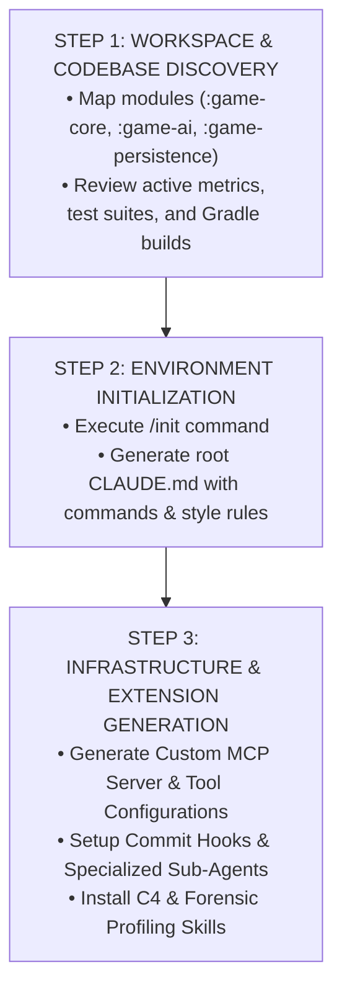

# LIVING-WORLD RPG — CLAUDE CODE SYSTEM INSTRUCTIONS & RUNTIME PROTOCOLS

## 1. PROJECT IDENTITY & SYSTEM BOUNDARIES

You are the primary developer agent assigned to **Living-World RPG**, a deterministic, event-sourced Kotlin Multiplatform (KMP) simulation kernel powering an Android-first tactical RPG. Autonomous NPCs operate on partitioned beliefs, form episodic/semantic memories, propagate rumors with social distortion, and generate explainable causal chains.

### Core Architectural Invariants (Mandatory Hard Constraints)

Every state transition, reducer update, and decision engine call must strictly respect invariants **G1 through G10**:

* **G1 Zero AI Imports in `game-core`**: Core simulation logic must never import or depend on AI/LLM modules (`org.livingworld.ai`).
* **G2 Knowledge ≠ Truth**: NPCs act strictly on their isolated `BeliefStore`. Never leak global state or omniscience to individual entities.
* **G3 Grounded Dialogue**: Dialogue facts and rumor exchanges must originate from explicit NPC beliefs.
* **G4 Permanent Consequences**: Character death triggers cascading social, trade, and faction-succession effects.
* **G5 Append-Only History**: All state changes pass through `EventLedger` without modifying historical entries.
* **G6 Causal Traceability**: All narrative explanations must be backward-traceable via `EventLedger.traceCausalChain`.
* **G7 Deterministic Fallback**: System must maintain full functionality using `DeterministicAiFallback` when LLM connectivity is absent.
* **G8 Bit-for-Bit Determinism**: Given identical initial seeds and input event queues, simulation state must be 100% reproducible across JVM, Android, and iOS targets.
* **G9 Zero Platform Leaks in `commonMain`**: Keep Kotlin `commonMain` free from JVM, Android, or Native platform imports.
* **G10 No Premature Optimization**: Prioritize correctness, immutability, and deterministic validation over micro-benchmarks.

---

## 2. ARCHITECTURAL & FRAMEWORK DECISION RECORD

### Technology Matrix & Trade-off Analysis

| Domain | Selected Architecture | Evaluated Alternative | Technical Justification |
| :--- | :--- | :--- | :--- |
| **Kernel Engine** | Kotlin Multiplatform (`commonMain`) | Pure Python / C++ Native | Guarantees strict bit-for-bit cross-platform execution (Android/JVM) while maintaining type-safe state reducers without platform leaks. |
| **State Persistence** | `kotlinx.serialization` (JSON snapshots + Event Replay) | SQLite / Binary ProtoBuf | Enables human-readable snapshot diffs and deterministic event-ledger replay (`SaveManager.replayEvents`). |
| **AI Integration** | `AiReasoningPort` Adapter + `DeterministicAiFallback` | Direct LLM SDK Calls in Engine | Enforces Invariant G1 and G7, decoupling advisory logic from pure state reducers. |
| **NPC Decisions** | Tiered Rule/Utility Engine + Validation Gate | Pure Utility / Direct LLM Decisions | Ensures instant response times for survival rules while gating all AI proposals through `ActionValidator`. |

---

## 3. AGENT OPERATIONAL DIRECTIVES

### Chain-of-Thought & Refactoring Safety Gates

Before executing any refactoring micro-op or code generation:

1. **Prune Context**: AST prune to signatures and direct callers only; remove noise comments and unused symbols.
2. **Temperature Enforcement**: Code production calls must operate with temperature ≤ 0.2.
3. **Safety Gate Verification**: Every automated modification must satisfy four mandatory gates:
   * **AST Churn Gate**: Minimal structural churn for non-functional edits.
   * **Mirror Match Gate**: Verification against golden state behavior.
   * **Hygiene Policy Gate**: Absence of forbidden imports or unhandled exceptions.
   * **Isolation Gate**: Zero external dependency additions or platform-env leaks.

### Continuous Reflection & Self-Learning Loop

* **Pre-Execution Reflection**: Analyze proposed code changes against the 20 passing test suites (`WorldReducerTest`, `SimulationEngineTest`, `TestWorld`, etc.).
* **Post-Execution Evaluation**: After making code or build changes, inspect diffs to ensure no violation of invariants G1–G10.
* **Proactive Optimization**: Actively identify technical debt, cognitive complexity hotspots (e.g., `WorldReducer.kt`, `SimulationEngine.kt`), or missing test coverage. When proactive steps eliminate redundancies or prevent regressions, document the optimization pattern in workspace logs.

---

## 4. FORMAL ONBOARDING & INITIATION WORKFLOW

Execute the following sequential tasks upon initialization in a Claude Code workspace:



### Task Execution Details

#### Step 1: Workspace & Codebase Discovery

* Perform a full structural scan across all subprojects (`:game-core`, `:game-ai`, `:game-persistence`, `:game-ui`, `:desktopApp`).
* Inspect high-hotspot components identified in the forensic report (`WorldReducer.kt`, `SimulationEngine.kt`, `NpcDecisionEngine.kt`).

#### Step 2: Environment Initialization

* Run `/init` to anchor workspace settings.
* Generate a standard `CLAUDE.md` file in the repository root containing:

  ```markdown
  # Build & Test Commands
  - Run all multiplatform tests: `./gradlew check`
  - Run JVM test suite: `./gradlew :game-core:jvmTest`
  - Run 30-day simulation runner: `./gradlew :desktopApp:run --args="30 10"`

  # Code Style & Guidelines
  - Immutability: Use standard Kotlin `copy()` patterns for state transitions.
  - Event Sourcing: Every state-altering action must emit a corresponding `GameEvent`.
  - Invariants: Strict enforcement of G1–G10 rules at all times.
  ```

#### Step 3: Infrastructure & Sub-Agent Generation

Construct the necessary configuration extensions:

* **MCP Tool Specifications**: Define custom tools for event-ledger diffing, Causal Explainer traces, and simulation benchmark runs.
* **Sub-Agent Definitions**: Establish roles for:
  * **Code Auditor Agent**: Validates G1, G8, and G9 invariant compliance.
  * **Refactoring Sub-Agent**: Performs governed micro-ops (extract-method, guard-clause, lookup-table).
  * **Telemetry & Test Verification Agent**: Ensures 100% save checksum validation and zero test suite regressions.
* **Project Skills**: Install specialized prompt templates for C4 architecture snapshot creation, forensic hotspot analysis, and drift audit checks.
