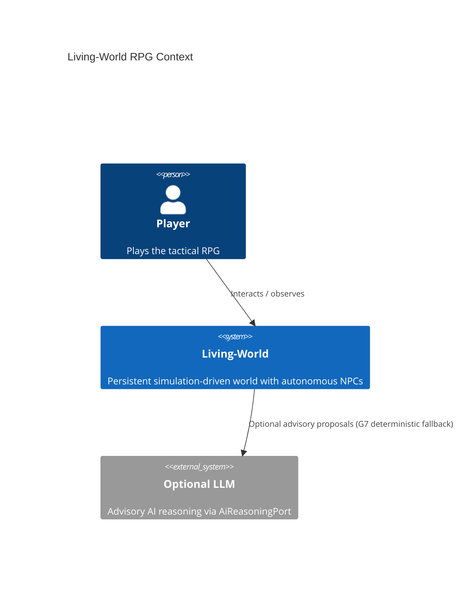
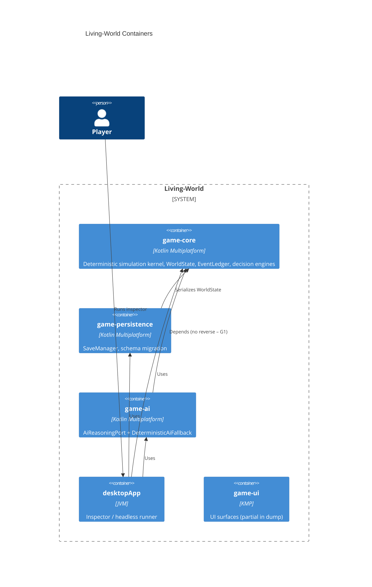

# Living-World C4 Snapshot (v6)

Generated by living-docs-c4 skill. Source: living-world-v6 on Google Drive.

## Context

## Containers

## Key Components (game-core)

- **WorldState / WorldReducer** – single source of truth + pure reducer
- **EventLedger / GameEvent** – append-only history (G5)
- **SimulationEngine / NpcDecisionEngine / ActionValidator** – tick loop & decisions
- **Npc / Goal / Belief / Memory / Relationship / Faction** – social simulation entities
- **SimulationInspector / CausalExplainer** – observability

## Invariants (must never be violated)

G1 Zero AI imports in game-core  
G2 Knowledge ≠ Truth  
G3 Dialogue grounded in beliefs  
G4 Death has permanent cascading consequences  
G5 History persists (append-only)  
G6 Causal explanations  
G7 Deterministic fallback without LLM  
G8 Bit-for-bit determinism  
G9 Zero platform leaks in commonMain  
G10 No premature optimization

## Hotspot priorities (from forensic-code-engine)

1. `simulate_village.py` (high LOC + decision density – external script)
2. `WorldReducer.kt`
3. `SimulationEngine.kt`
4. `GameEvent.kt`
5. `NpcDecisionEngine.kt` / `ActionValidator.kt`

Recommend RefactoringMirror micro-ops only after safety gates + governed prompts; keep G1/G7/G8 intact.
